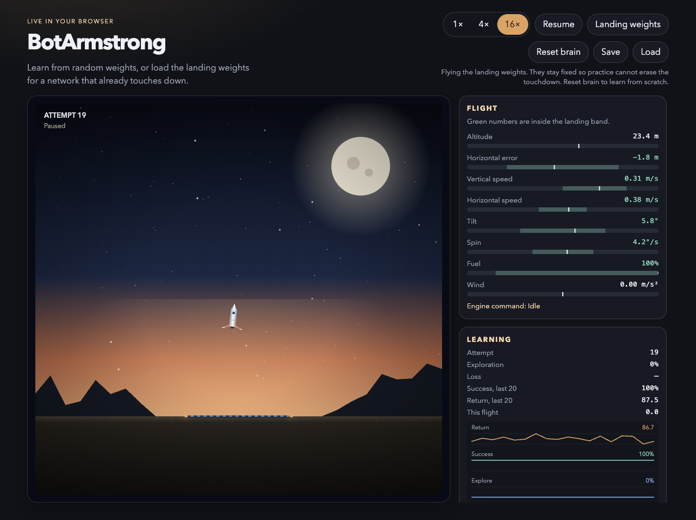
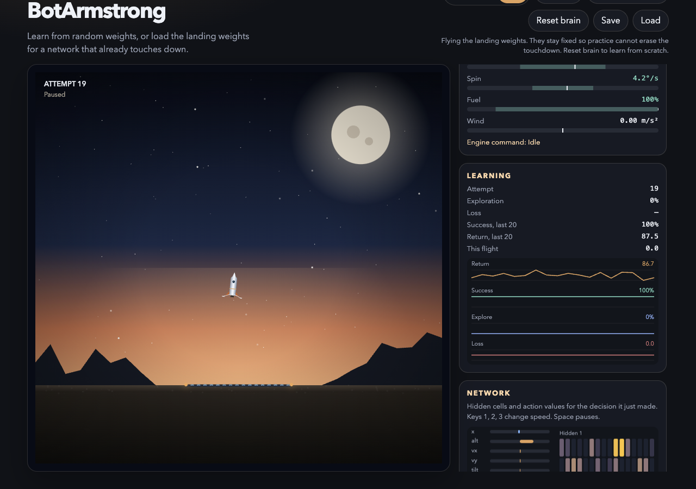
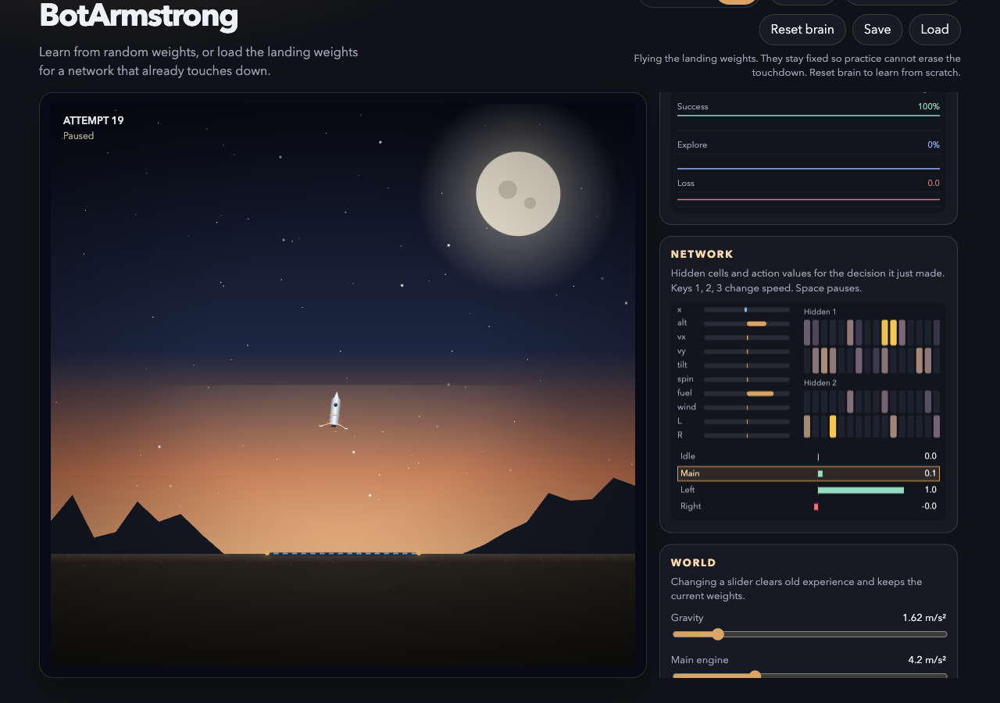
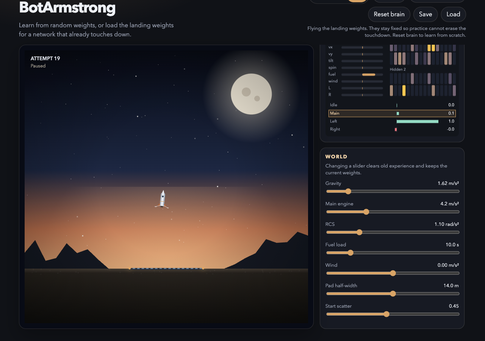

# BotArmstrong

A rocket learns to land in your browser. Nothing is installed to watch it: open the site, and the simulation, the pictures, and the training all run in that tab.

**Live site:** [https://pratik-mk.github.io/BotArmstrong/](https://pratik-mk.github.io/BotArmstrong/)



## What you are looking at

The page has a dusk landing view on the left and four instrument panels on the right. The rocket is drawn every frame from the physics state. The panels are the same numbers the network sees and the scores it is trained on.

The network has four choices: **Idle**, **Main** (thrust along the nose), **Left**, and **Right**. It starts from random weights unless you load the saved landing weights. There is no scripted autopilot on the page.

## Controls

| Control | What it does |
| --- | --- |
| **1×**, **4×**, **16×** | How fast simulated time runs. 1× is one flight in real time. 16× is for practicing many attempts. Keys `1`, `2`, and `3` do the same. |
| **Pause** / **Resume** | Freezes the rocket and the training. `Space` does the same, unless you are typing in a slider. |
| **Landing weights** | Loads a saved network that already knows how to touch down. Exploration drops to 0%, so every flight uses those weights. Updates stay off so later practice cannot erase the landing. |
| **Reset brain** | Throws the weights away and starts again from random values. Training turns back on. This is the “learn it yourself” mode. |
| **Save** | Stores the current weights, charts, and attempt count in this browser only (`localStorage`). |
| **Load** | Restores that browser copy. It is separate from the landing-weights file shipped with the site. |

The note under the buttons explains which mode you are in.

## The landing view

The canvas shows the moon, the ground, the marked pad, the rocket, its flame or rotation puffs, and a short trail. The corner reads the attempt number and either **Training**, **Landing weights**, or **Paused**.

A banner names how the flight ended:

| Banner | Meaning |
| --- | --- |
| **Touchdown** | Both legs are on the pad, and speed, tilt, and spin are inside the landing band. |
| **Vehicle lost** | The rocket hit the ground too fast, too tilted, off the pad, nose-first, or left the arena. |
| **Out of time** | The flight ran for 20 seconds (600 steps at 30 per second) without touching down. |

A landing has to meet all of these at touchdown:

- both feet on the pad
- sideways speed at most 1.5 m/s
- downward speed at most 2 m/s
- tilt within about 20°
- spin within about 29°/s

Anything else that touches the ground is a crash. Fuel is a tank from 0 to 100%. At 0% the engines do nothing.

## Flight

Green numbers are inside the band that counts as a safe landing. The shaded stretch on a meter is that band. The rocket is trying to drive each of these into the green before the legs touch.

| Readout | Meaning |
| --- | --- |
| **Altitude** | Height of the rocket above the ground, in metres. |
| **Horizontal error** | Distance left or right of the pad center. Negative is left. |
| **Vertical speed** | Climb is positive, descent is negative. A soft landing is between −2 and 2 m/s. |
| **Horizontal speed** | Sideways speed. A soft landing is within ±1.5 m/s. |
| **Tilt** | Nose angle. 0° is upright. Positive tips the nose to the right. |
| **Spin** | How fast the nose is rotating, in degrees per second. |
| **Fuel** | Tank remaining. Thrust and rotation both burn it. Main engine burns faster. |
| **Wind** | Sideways acceleration from the World slider, in m/s². |
| **Engine command** | The action just chosen: Idle, Main, Left, or Right. |

## Learning



These numbers describe the last flights, not the rocket’s position.

| Stat | Meaning |
| --- | --- |
| **Attempt** | Which flight this is. It increases after each touchdown, crash, or timeout. |
| **Exploration** | Chance the next action is random instead of the network’s best guess. A fresh brain starts at 100% and falls to 5%. Landing weights stay at 0%. |
| **Loss** | How far the network’s scores were from the scores it was aiming for on the last update. A dash means it has not updated yet. |
| **Success, last 20** | Share of the last 20 finished flights that were touchdowns. |
| **Return, last 20** | Average score of those flights. Higher is better. A clean landing with the saved weights is about 87. |
| **This flight** | Score accumulated since the current flight began. |

The chart has four bands, newest flights on the right:

- **Return** (amber): score of each finished flight.
- **Success** (teal): touchdown rate over the recent flights, as a percent.
- **Explore** (blue): exploration percent.
- **Loss** (red): training error. It sits on the bottom band.

The score for a flight is reward shaping plus a bonus or penalty at the end. Shaping pays the rocket for getting closer to a slow, upright, low-spin state and charges it a little fuel. A touchdown adds a bonus. A crash or a timeout subtracts. The shaping is what gives the network a direction before it has ever landed.

## Network



This is the decision the rocket just made. It is a small network: 10 inputs, two hidden layers of 32 cells, and 4 action scores.

The left bars are the inputs, scaled and clipped so they fit the network:

| Input | Meaning |
| --- | --- |
| **x** | Horizontal error. |
| **alt** | Altitude. |
| **vx**, **vy** | Horizontal and vertical speed. |
| **tilt**, **spin** | Angle and rotation. |
| **fuel** | Tank remaining. |
| **wind** | The wind acceleration. |
| **L**, **R** | Left and right leg sensors. They turn on when a foot is close to the ground. |

**Hidden 1** and **Hidden 2** are the two inner layers. A brighter cell is more active for this decision.

**Idle**, **Main**, **Left**, and **Right** are the scores for the four actions. The highlighted row is the action that was taken. A solid outline means the network chose it. A dashed outline means exploration picked it at random. Teal bars are positive scores, red bars are negative.

## World



These sliders are the numbers the simulation actually uses. They are not cosmetic.

| Slider | Default | What it changes |
| --- | --- | --- |
| **Gravity** | 1.62 m/s² | Pull toward the ground. 1.62 is lunar gravity. Higher makes the rocket fall faster. |
| **Main engine** | 4.2 m/s² | Thrust acceleration along the nose. It has to beat gravity to hover. |
| **RCS** | 1.10 rad/s² | How fast Left and Right can rotate the rocket. |
| **Fuel load** | 10.0 s | Seconds of continuous main-engine burn in a full tank. |
| **Wind** | 0.00 m/s² | Steady sideways push. Negative pushes left. |
| **Pad half-width** | 14.0 m | Half the width of the landing pad. The legs have to be inside it. |
| **Start scatter** | 0.45 | How different each flight’s start is. 0 repeats the same start. 1 scatters position, tilt, and speed widely. |

Moving a slider clears the network’s memory of old flights and keeps the current weights, so the next flights adapt to the new world. The note under the buttons says when that happens.

## Two ways to use it

**Watch a landing.** Click **Landing weights**. The saved network flies with exploration at 0%. In a check of that file, nearly every flight touches down, and on the page the recent success rate sits at 100% with a return around 87. Those weights stay fixed.

**Let it learn.** Click **Reset brain**. Weights are random again, exploration starts near 100%, and every flight updates the network. Early flights crash. Success climbs only after the network has found the landing often enough to keep it. Use 16× if you want many attempts quickly.

Training never leaves the browser. Save and Load only use that browser’s storage.

## Run it locally

```bash
npm install
npm run dev
```

Open the URL Vite prints.

`npm run train-check` runs the same physics and network without drawing, and checks that later flights score higher than early ones and that some of them land.

`npm run build` writes the static site to `dist/`.

## GitHub Pages

The live site is [https://pratik-mk.github.io/BotArmstrong/](https://pratik-mk.github.io/BotArmstrong/).

Pushes to `main` run `.github/workflows/pages.yml`. That installs dependencies, runs `npm run build`, and publishes `dist/`. Asset paths are relative, so the project site and a local `dist/` folder both work. The landing-weights file is `public/landing-brain.json`; the build copies it next to the page so the **Landing weights** button can load it.
